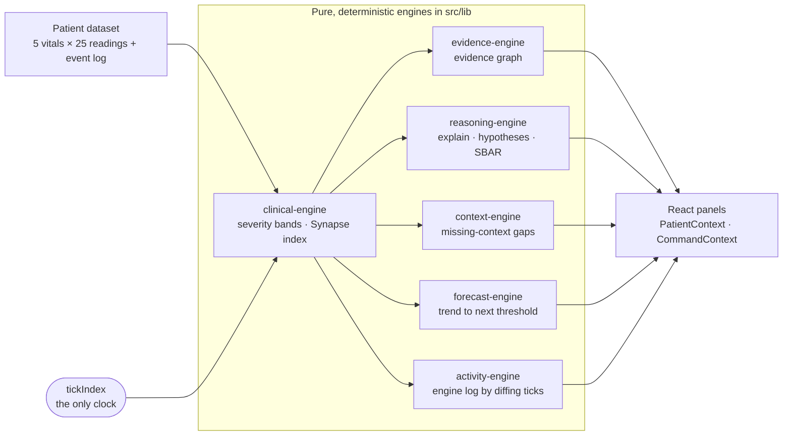

<div align="center">



<br/>

<p>
  <b><a href="https://YOUR-VERCEL-URL.vercel.app">Live demo</a></b> &nbsp;•&nbsp;
  <a href="#try-it-in-60-seconds">60-second walkthrough</a> &nbsp;•&nbsp;
  <a href="#one-signal-end-to-end">One signal, end to end</a> &nbsp;•&nbsp;
  <a href="#how-it-works">Architecture</a> &nbsp;•&nbsp;
  <a href="#for-reviewers">For reviewers</a>
</p>

<p>
  
  
  
  
  
  
  
</p>

<sub>Synthetic data only · Research and educational prototype · Not a diagnostic device · Not for clinical decision-making</sub>

<br/><br/>


</div>

<br/>

## The idea

When a patient is handed between teams, the dangerous part usually isn't missing data. It's that the data is scattered across labs, medication records, nursing notes and monitors, and nobody can quickly answer four questions:

| The question | Where SynapseMD answers it |
| --- | --- |
| **What changed?** | Live vitals, the *What changed* comparison, the engine log |
| **Why might it matter?** | Hypothesis explorer, forecast horizon |
| **What evidence supports that?** | Evidence graph, a reasoning trace on every event |
| **What's still missing?** | The unresolved-context detector |

It is **not a chatbot**. The main interaction is exploring a patient's state over time, and the reasoning is deterministic, inspectable code, so every output can be traced back to its inputs.

<div align="center">

| 3 patients | 9 views | 5 vitals × 25 readings | 6 event types | 59 tests | 0 `Math.random` |
| :---: | :---: | :---: | :---: | :---: | :---: |

</div>

## Try it in 60 seconds

1. **Click *Tour*** in the top bar. A scripted walkthrough drives the live app: it scrubs time, switches views, replays the evidence graph and generates a handoff.
2. **Drag the time scrubber backwards.** Every panel rewinds to exactly what it would have shown at that moment, including the engine log and the ward ranking.
3. **Open *Ward board*** and scrub. Three patients re-rank by Synapse index with a FLIP reorder animation.
4. **Open *Unresolved context*** at the end of Arthur's record. A critical alert has no response. Go to *Ingest record*, drop any `.txt` file, and come back. The gap has closed.
5. Press **`⌘K` / `Ctrl+K`** and type `show potassium`, `what changed today` or `generate handoff`. Press `?` for keyboard shortcuts and `1`–`9` to jump between views.

## One signal, end to end

Here is what happens to a single abnormal reading, Arthur Pendelton's potassium, across the engines. Each row is a real behaviour you can reproduce by scrubbing his record.

| When | What the system does | Where you see it |
| --- | --- | --- |
| Hour 4 | A medication event, *Lisinopril 10 mg administered*, is recorded | Timeline |
| Hour 6 | Potassium leaves its normal band; the vital turns amber | Overview, severity bands |
| Hours 6 to 9 | No lab, note or order mentions it, so a gap opens: *outside normal range with no related follow-up* | Unresolved context |
| Hour 6 onward | *Medication-related signal* ranks first among the hypotheses, with a synthetic confidence and its supporting and contradicting evidence | Hypothesis explorer |
| Hour 10 | A potassium re-check is ordered; the gap closes on its own | Unresolved context, engine log |
| Hour 12 | The monitor flags a critical reading with no clinician response, so a new critical gap opens | Unresolved context, alarm pulse |
| Any time | Ingest a note and that gap closes. The same record feeds the SBAR, which links back to each source | Ingest record, Handoff |

Nothing in that table is scripted. Each row is the output of a pure function over the same patient record and the current moment.

## What's inside

| View | What it does |
| --- | --- |
| **Overview** | Live vitals with sparklines, the *Synapse State Index* (a transparent weighted composite, explicitly not a validated score), a radar "vital fingerprint", an animated forecast and a tick-by-tick engine log. |
| **Ward board** | Every patient ranked at the same instant, with index history, worst signal and open-gap count. |
| **Timeline** | Chronological events across six types. Click one for the source record with the relevant phrase highlighted and a six-step reasoning trace. |
| **Ingest record** | Drop a `.txt`, `.json`, `.xml` or `.raw` file. A staged pipeline runs and a real event is added to the patient's state, which updates every other view. |
| **Evidence graph** | A React Flow graph of the relationships behind the current worst signal. Every node opens its source record. |
| **Hypotheses** | Ranked, record-level explanations, each with supporting evidence, contradicting evidence, missing information and temporal relationships. Confidence is labelled *synthetic*. |
| **Unresolved context** | Finds what the record lacks: abnormal readings with no follow-up, steady drift nothing acknowledges, critical alerts with no clinician response, medication changes with no stated reason. |
| **What changed** | Pick any two points in the record and compare vitals, medications and event volume. |
| **Handoff (SBAR)** | A streamed Situation / Background / Assessment / Recommendation report built from current state. Each section links to its evidence, and you can copy or download it. |

Also included: a command palette, keyboard shortcuts, toast alerts when a vital crosses into critical, and three synthetic patients with different clinical patterns: post-CABG hyperkalemia, pneumonia with desaturation, and post-operative hypotension with low potassium.

## How it works



Four decisions shape the codebase.

**1. Time is the only state.** Every panel is a pure function of *which patient* and *which tick*. There is no hidden per-panel state to drift out of sync. That is why the time scrubber and the guided tour need no special cases: they move the tick and everything re-derives.

**2. Engines know nothing about React.** All reasoning lives in plain TypeScript modules under `src/lib`, each with unit tests. Components render; they don't decide.

**3. Reasoning sits behind an interface.** The UI only talks to `ReasoningProvider`:

```ts
interface ReasoningProvider {
  explainEvent(event, context): ReasoningStep[];
  generateHypotheses(tickIndex, events, series): ClinicalHypothesis[];
  generateSBAR(tickIndex, events, series, patient): SBARReport;
}
```

`LocalReasoningProvider` implements it deterministically. Swapping in a model-backed provider means writing one class, not touching a component.

**4. Nothing is asserted without a source.** Events, graph nodes, hypotheses, gaps and SBAR sections all open the underlying synthetic record. The engine log is derived by diffing consecutive ticks, so it rewinds correctly instead of being an append-only list.

## Engineering notes

- **Deterministic by construction.** There are no calls to `Math.random`. All telemetry comes from closed-form formulas, so runs are reproducible and tests are stable.
- **Tested at two levels.** 49 unit tests cover the engines, run against all three patients where relevant. 10 jsdom smoke tests mount the real landing page and dashboard and drive every view, patient switching, the command palette, file ingestion, SBAR streaming and the full tour. They fail on render errors, infinite update loops and duplicate keys.
- **Strict TypeScript** with `noUncheckedIndexedAccess`, and seven runtime dependencies in total.
- **Forecasts that know when to stay quiet.** The horizon is a least-squares trend gated on R², so noise doesn't produce a confident-looking number.
- **Performance.** The React Flow tab is code-split out of the initial bundle (dashboard route 138 kB, 255 kB first load).
- **Accessible motion.** Animations respect `prefers-reduced-motion`. Dialogs have roles and labels, every panel is keyboard reachable, and `Esc` closes overlays.
- **Production hygiene.** Error boundaries at route and global level, security headers, a dynamic Open Graph image, and a CI workflow that runs typecheck, lint, tests and a production build.

## Responsible AI stance

> [!IMPORTANT]
> SynapseMD is a demonstration built on synthetic data. It does not connect to real health records, does not make diagnoses, and no number it shows is a validated clinical probability.

- Language is deliberately non-diagnostic: *potential signal*, *temporal association*, *requires human review*.
- The Synapse index and hypothesis confidences are labelled **synthetic** wherever they appear.
- No real patient data, no external AI service, and no fabricated medical citations.
- Absence of evidence is a first-class output (the context detector) instead of being hidden behind a confident answer.

## For reviewers

If you have five minutes with the code, these are the files that show the most:

| File | Why it's worth opening |
| --- | --- |
| [`src/lib/reasoning-engine.ts`](src/lib/reasoning-engine.ts) | The `ReasoningProvider` interface and its local implementation: the seam where a model would plug in. |
| [`src/lib/context-engine.ts`](src/lib/context-engine.ts) | The missing-context detector. Small rules, each covered by a test. |
| [`src/lib/forecast-engine.ts`](src/lib/forecast-engine.ts) | Trend extrapolation gated on fit quality, including the recovering-versus-worsening case. |
| [`src/components/dashboard/useFlipReorder.ts`](src/components/dashboard/useFlipReorder.ts) | A FLIP animation hook for list re-ranking, with reduced-motion handling. |
| [`src/components/dashboard/GuidedTour.tsx`](src/components/dashboard/GuidedTour.tsx) | A tour that drives real application state instead of overlaying screenshots. |
| [`src/app/smoke.test.tsx`](src/app/smoke.test.tsx) | Smoke tests that mount the real UI in jsdom and exercise every major flow. |

## Run it locally

```bash
npm install
npm run dev        # http://localhost:3000
npm test           # 59 tests
npm run typecheck
npm run lint
npm run build
```

No API keys, backend or environment variables are needed.

<details>
<summary><b>Project structure</b></summary>

```
src/
  app/                       Landing page, dashboard shell, error boundaries, OG image, robots, sitemap
  components/
    dashboard/               One component per panel, plus contexts and hooks
    landing/                 Landing-page components (live hero monitor, previews)
    ui/                      Button, severity indicators, animated number
    patient/PatientContext   Active patient, playback and ingestion state
  lib/
    mock-data.ts             Three deterministic patient datasets
    clinical-engine.ts       Severity bands, Synapse index, comparison
    evidence-engine.ts       Evidence graph construction
    reasoning-engine.ts      ReasoningProvider and its local implementation
    context-engine.ts        Missing-context detection
    forecast-engine.ts       Trend extrapolation
    activity-engine.ts       Engine log by diffing ticks
    ingestion-engine.ts      Simulated document parsing
    *.test.ts                Engine unit tests
docs/
  banner.svg                 README banner
  screenshots/               README screenshots
```

</details>

<details>
<summary><b>Tech stack</b></summary>

| | |
| --- | --- |
| Framework | Next.js 15 (App Router), React 19 |
| Language | TypeScript (strict) |
| Styling | Tailwind CSS 3 with a token-based design system |
| Visualisation | Recharts, React Flow, hand-built SVG |
| Icons | Lucide |
| Testing | Vitest, Testing Library, jsdom |
| Hosting and CI | Vercel, GitHub Actions |

</details>

## Deploying

Import the repository in Vercel and deploy. The framework is detected automatically and no settings are required. The Open Graph URL resolves from Vercel's production domain. Set `NEXT_PUBLIC_SITE_URL` only if you add a custom domain.

## Limitations and next steps

- It runs on Next 15.5. `npm audit` still lists PostCSS findings inside Next's build toolchain whose fix ships in Next 16. They concern processing untrusted CSS at build time, which this app doesn't do, and it uses no server actions, middleware, rewrites or `next/image`.
- The jsdom smoke tests have no layout engine, so they don't replace a real-browser end-to-end or visual regression pass. A Playwright suite against the Vercel preview is the obvious next step.
- Mobile is a working fallback; desktop is the designed experience.
- **If this grew into a real system:** add an LLM-backed `ReasoningProvider` whose output is constrained to cite evidence-graph node IDs and is rejected if any claim lacks a resolvable source, and ingest real FHIR R4 resources instead of the simulated parser.

---

<div align="center">
<sub>Built as a portfolio project exploring explainable, evidence-linked AI reasoning over longitudinal patient data.<br/>Synthetic data only.</sub>
</div>
